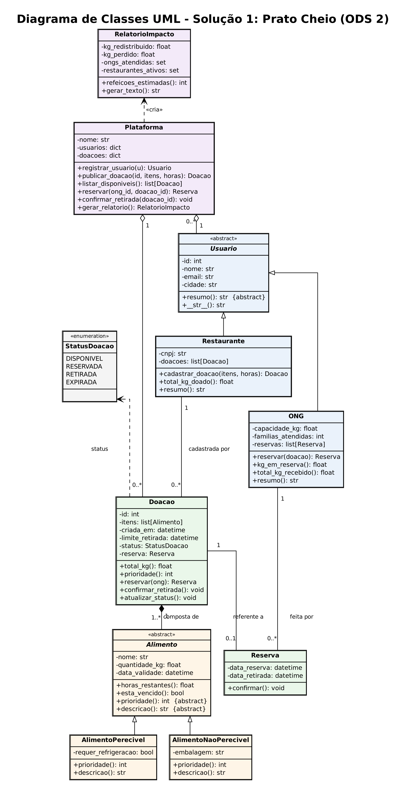

# 🍽️ Prato Cheio

Protótipo em Python (console) de uma plataforma que conecta **restaurantes que têm excedente de comida** a **ONGs que alimentam pessoas em situação de vulnerabilidade**.

Projeto da disciplina de Programação Orientada a Objetos — tema *Tecnologia para o Impacto Social*.

**ODS relacionados:** ODS 2 (Fome Zero e Agricultura Sustentável) e ODS 12 (Consumo e Produção Responsáveis, meta 12.3 – reduzir o desperdício de alimentos).

## Como executar

Requisito: Python 3.9 ou superior (não usa bibliotecas externas).

```bash
python main.py          # menu interativo
python main.py --demo   # demonstração automática de todo o fluxo
```

## Como funciona

1. Restaurantes cadastram **doações** (lista de alimentos + prazo para retirada).
2. A plataforma lista as doações disponíveis, das **mais urgentes** (perecíveis perto de vencer) para as menos urgentes.
3. ONGs **reservam** uma doação, respeitando sua capacidade de armazenamento.
4. Após a **retirada**, o sistema gera um **relatório de impacto** (kg redistribuídos, refeições estimadas, alimento perdido).

## Estrutura

```
prato_cheio/
├── prato_cheio/
│   ├── modelos.py       # Usuario, Restaurante, ONG, Alimento, AlimentoPerecivel,
│   │                    # AlimentoNaoPerecivel, Doacao, Reserva, StatusDoacao
│   └── plataforma.py    # Plataforma, RelatorioImpacto
├── docs/
│   ├── diagrama_classes.png   # Diagrama UML
│   └── gerar_diagrama.py
└── main.py              # Menu interativo e demo
```

## Conceitos de POO aplicados

| Conceito | Onde |
|---|---|
| **Encapsulamento** | Atributos privados (`_nome`, `_status`...) acessados por `@property`; `Doacao.itens` devolve uma tupla (cópia) para a lista interna não ser alterada de fora; validações nos construtores. |
| **Herança** | `Restaurante` e `ONG` herdam de `Usuario`; `AlimentoPerecivel` e `AlimentoNaoPerecivel` herdam de `Alimento`. |
| **Polimorfismo** | `Usuario.resumo()` e `Alimento.prioridade()` / `descricao()` são abstratos e cada subclasse implementa à sua maneira. A `Plataforma` ordena doações por urgência sem saber o tipo de cada alimento. |
| **Abstração** | `Usuario` e `Alimento` são classes abstratas (`ABC`). |
| **Composição** | `Doacao` é composta de `Alimento`s (os itens pertencem à doação). |
| **Agregação** | `Plataforma` agrega `Usuario`s e `Doacao`ões. |

## Diagrama de classes



## Autor

Ana Paula da Cruz Pinha — 25210057
