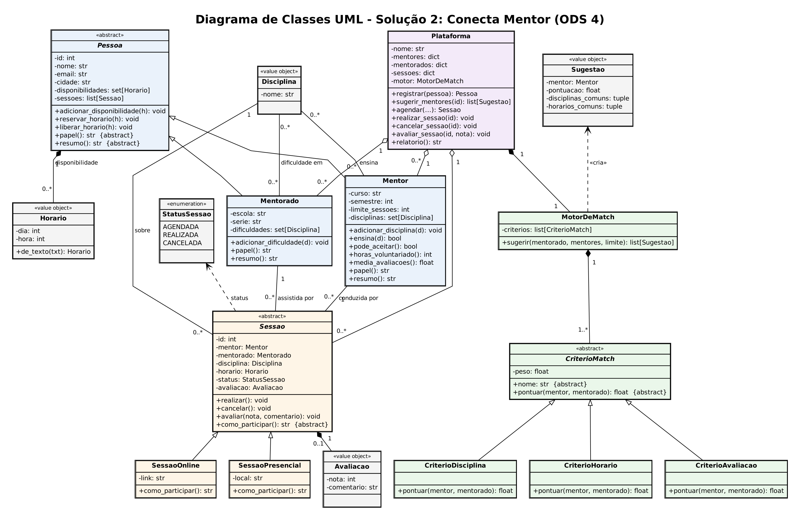

# 🎓 Conecta Mentor

Protótipo em Python (console) de uma plataforma que conecta **universitários voluntários (mentores)** a **estudantes da rede pública (mentorados)** para sessões gratuitas de reforço escolar.

Projeto da disciplina de Programação Orientada a Objetos — tema *Tecnologia para o Impacto Social*.

**ODS relacionado:** ODS 4 (Educação de Qualidade). Também dialoga com o ODS 10 (Redução das Desigualdades).

## Como executar

Requisito: Python 3.9 ou superior (não usa bibliotecas externas).

```bash
python main.py          # menu interativo
python main.py --demo   # demonstração automática de todo o fluxo
```

## Como funciona

1. Mentores informam as disciplinas que ensinam e seus horários livres; mentorados informam as disciplinas em que têm dificuldade e seus horários livres.
2. O **motor de match** sugere os mentores mais compatíveis, combinando critérios com pesos: **disciplinas** (peso 5), **horários** (peso 3) e **avaliações** (peso 2). Só aparecem mentores viáveis (ensinam algo que o aluno precisa, têm horário em comum e vaga).
3. A sessão é agendada (online ou presencial) e os horários dos dois ficam reservados.
4. Depois de realizada, a sessão pode ser avaliada. Cada sessão realizada gera **horas de voluntariado/extensão** para o mentor.
5. O relatório mostra o impacto: alunos atendidos, horas de reforço, nota média e disciplinas mais procuradas.

## Estrutura

```
conecta_mentor/
├── conecta_mentor/
│   ├── modelos.py       # Pessoa, Mentor, Mentorado, Disciplina, Horario, Sessao,
│   │                    # SessaoOnline, SessaoPresencial, Avaliacao, StatusSessao
│   ├── match.py         # CriterioMatch (+3 critérios), MotorDeMatch, Sugestao
│   └── plataforma.py    # Plataforma
├── docs/
│   ├── diagrama_classes.png
│   └── gerar_diagrama.py
└── main.py              # Menu interativo e demo
```

## Conceitos de POO aplicados

| Conceito | Onde |
|---|---|
| **Encapsulamento** | Atributos privados + `@property`; `Disciplina`, `Horario` e `Avaliacao` são imutáveis (`dataclass(frozen=True)`) e validam seus dados; coleções são devolvidas como `frozenset`/tupla. |
| **Herança** | `Mentor` e `Mentorado` herdam de `Pessoa`; `SessaoOnline` e `SessaoPresencial` herdam de `Sessao`; os três critérios herdam de `CriterioMatch`. |
| **Polimorfismo** | `Sessao.como_participar()` devolve link (online) ou local (presencial); `CriterioMatch.pontuar()` calcula a nota de um jeito em cada critério; `Pessoa.resumo()`. |
| **Abstração** | `Pessoa`, `Sessao` e `CriterioMatch` são classes abstratas (`ABC`). |
| **Padrão Strategy** | O `MotorDeMatch` recebe uma lista de critérios intercambiáveis, então é possível trocar ou criar critérios sem alterar o motor. |
| **Composição** | `Pessoa` possui seus `Horario`s; `Sessao` possui sua `Avaliacao`; `Plataforma` possui o `MotorDeMatch`. |
| **Agregação** | `Plataforma` agrega `Mentor`es, `Mentorado`s e `Sessao`ões. |

## Regras de negócio protegidas pelo código

- Não agenda se o horário não está livre para os dois.
- Não agenda se o mentor não ensina a disciplina.
- Respeita o limite de sessões simultâneas de cada mentor.
- Só avalia sessões realizadas, e uma única vez.
- Cancelar libera os horários novamente.

## Diagrama de classes



## Autor

Ana Paula da Cruz Pinha — 25210057
