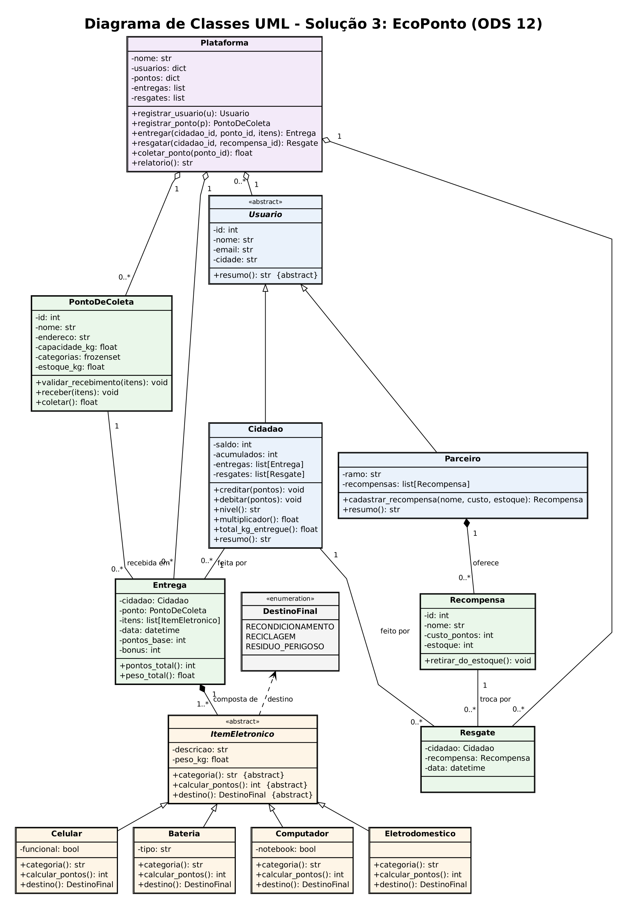

# ♻️ EcoPonto

Protótipo em Python (console) de uma plataforma de **logística reversa de lixo eletrônico**: o cidadão entrega celulares, baterias, computadores e eletrodomésticos em pontos de coleta, ganha **pontos** e troca por **recompensas** em comércios parceiros.

Projeto da disciplina de Programação Orientada a Objetos — tema *Tecnologia para o Impacto Social*.

**ODS relacionado:** ODS 12 (Consumo e Produção Responsáveis, meta 12.4 – gestão ambientalmente adequada de resíduos e 12.5 – redução da geração de resíduos por reciclagem e reúso).

## Como executar

Requisito: Python 3.9 ou superior (não usa bibliotecas externas).

```bash
python main.py          # menu interativo
python main.py --demo   # demonstração automática de todo o fluxo
```

## Como funciona

1. Cidadãos entregam itens em um **ponto de coleta**. Cada tipo de item vale uma quantidade diferente de pontos e tem um destino diferente (reúso, reciclagem ou descarte de resíduo perigoso).
2. O ponto de coleta valida o que aceita e o espaço que tem.
3. Quanto mais o cidadão entrega, maior o seu **nível** (Bronze 1.0x, Prata 1.1x, Ouro 1.2x de bônus nos pontos).
4. Os pontos são trocados por **recompensas** de parceiros locais.
5. Uma cooperativa **retira** o material do ponto, e o relatório mostra o impacto ambiental.

## Estrutura

```
ecoponto/
├── ecoponto/
│   ├── modelos.py       # Usuario, Cidadao, Parceiro, ItemEletronico, Celular, Bateria,
│   │                    # Computador, Eletrodomestico, DestinoFinal, PontoDeColeta,
│   │                    # Entrega, Recompensa, Resgate
│   └── plataforma.py    # Plataforma
├── docs/
│   ├── diagrama_classes.png
│   └── gerar_diagrama.py
└── main.py              # Menu interativo e demo
```

## Conceitos de POO aplicados

| Conceito | Onde |
|---|---|
| **Encapsulamento** | Atributos privados + `@property`; saldo, capacidade e estoque só mudam por métodos que validam (`debitar`, `receber`, `retirar_do_estoque`). |
| **Herança** | `Cidadao` e `Parceiro` herdam de `Usuario`; `Celular`, `Bateria`, `Computador` e `Eletrodomestico` herdam de `ItemEletronico`. |
| **Polimorfismo** | `calcular_pontos()`, `destino()` e `categoria()` têm uma implementação diferente em cada tipo de item; a `Entrega` soma os pontos sem saber o tipo de cada um. |
| **Abstração** | `Usuario` e `ItemEletronico` são classes abstratas (`ABC`). |
| **Composição** | `Entrega` é composta de `ItemEletronico`s; `Parceiro` possui suas `Recompensa`s. |
| **Agregação** | `Plataforma` agrega usuários, pontos de coleta, entregas e resgates. |

## Diagrama de classes



## Autor

Ana Paula da Cruz Pinha — 25210057
